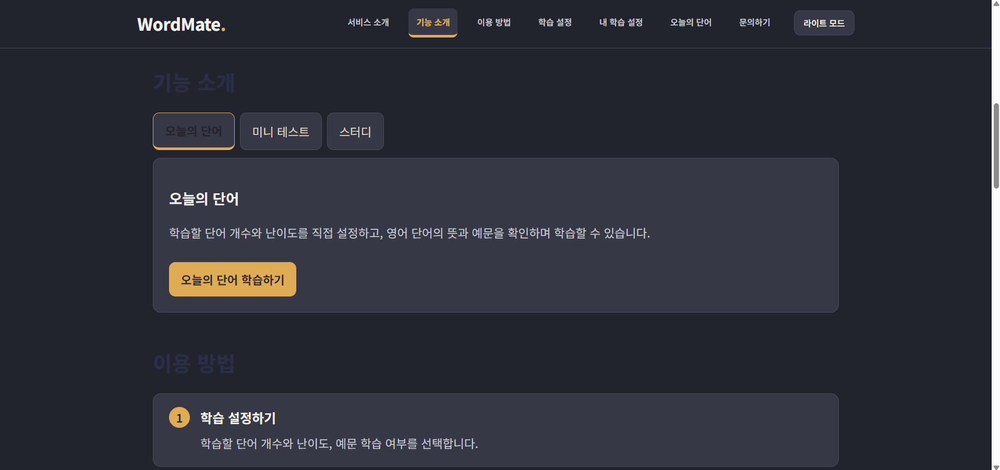
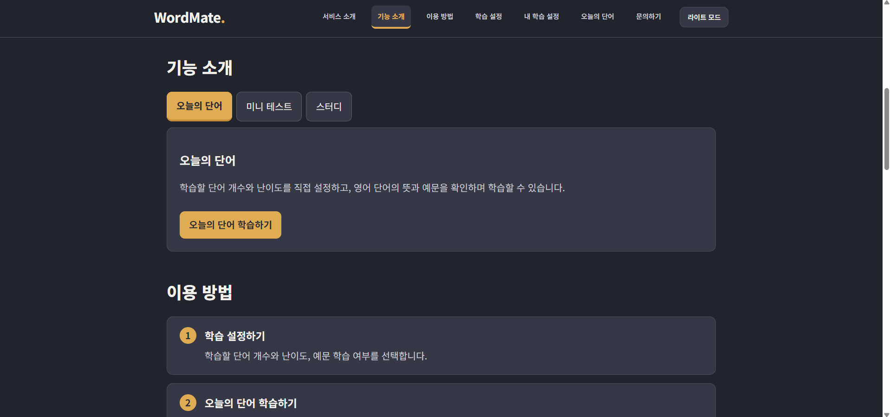
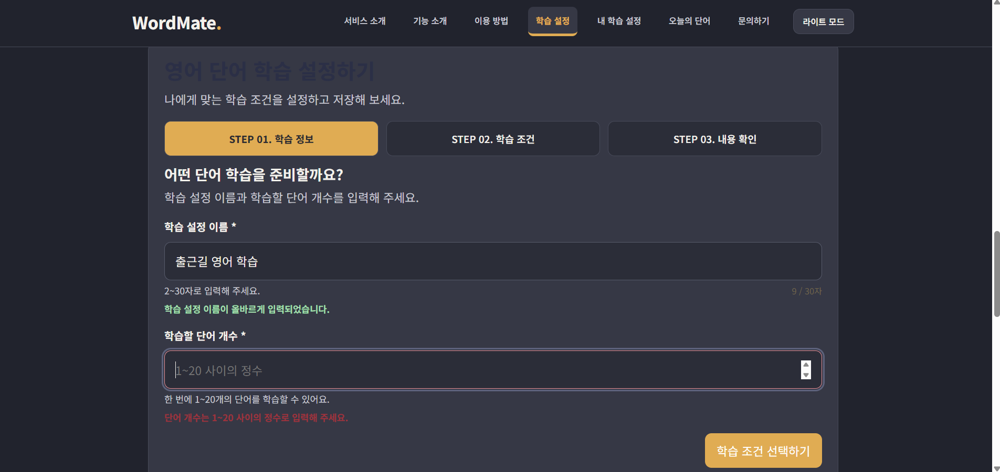
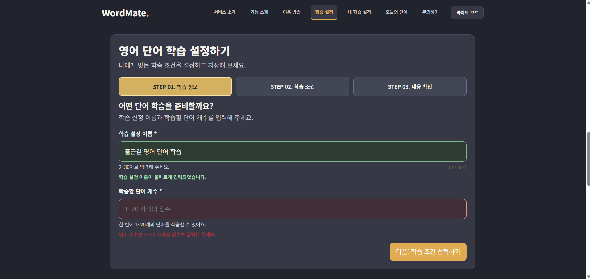
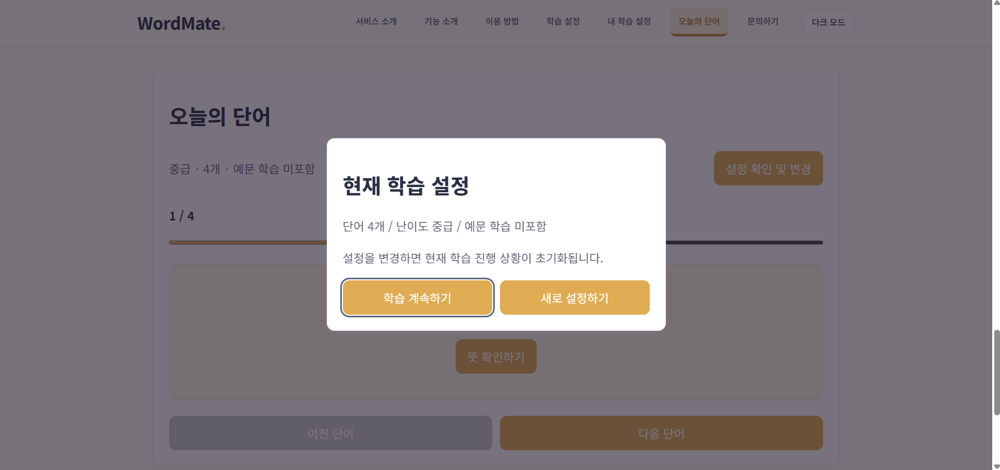
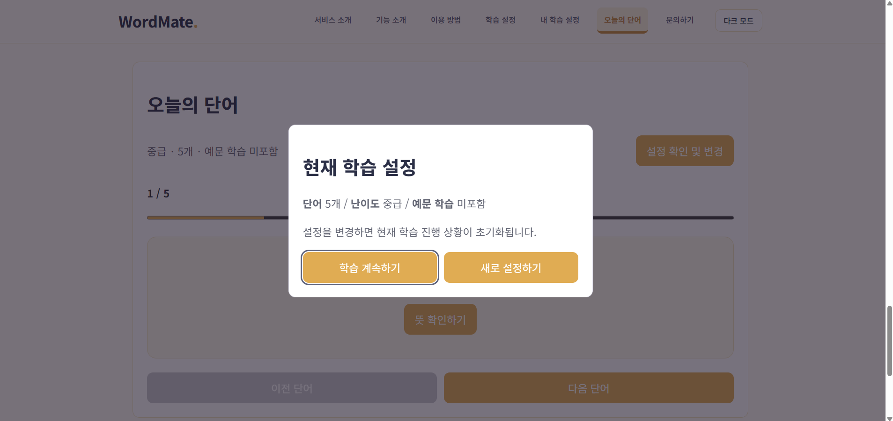
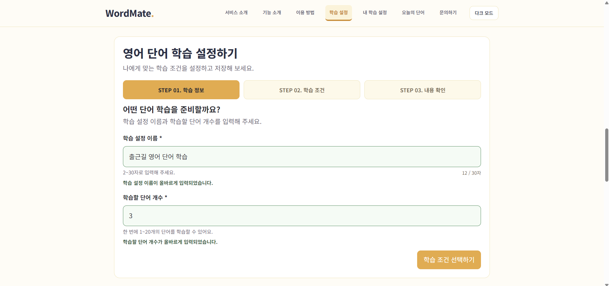
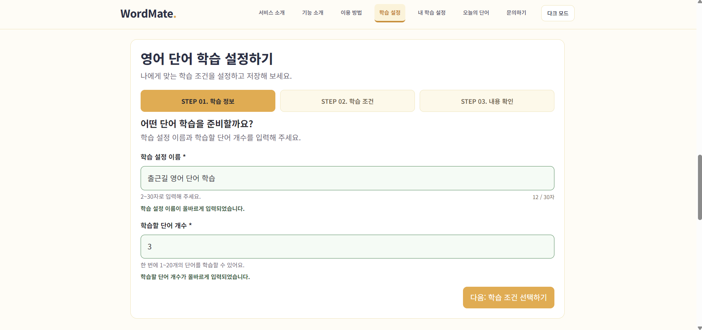

# WordMate - 영어 단어 학습 서비스

## 1. 서비스와 사용자 경험

- **서비스명:** WordMate
- **주요 사용자:** 영어 공부를 하고 싶은 직장인 및 학생
- **서비스 목적:** 사용자가 자신의 수준과 학습량에 맞춰 부담 없이 영어 단어를 학습하고, 꾸준한 영어 학습 습관을 형성할 수 있도록 돕는다.
- **주요 행동:**
  - 학습 조건 설정 → 오늘의 단어 학습 → (미니 테스트) → 학습 완료
  - (스터디 탐색 → 신청 폼 작성 → 스터디 가입 신청)

## 2. 11주차 주요 개선 내용

10주차까지 제작한 WordMate 웹페이지에 웹 접근성 원칙을 적용했다. 라이트 모드와 다크 모드의 색 대비를 점검하고, 입력 상태와 선택 상태를 더 쉽게 구분할 수 있도록 개선했다. 학습 설정 단계의 버튼 이름을 구체화하고, 키보드만으로도 주요 기능을 이용할 수 있도록 초점 표시와 이동 방식을 보완했다.

### 2-1. 색 대비와 정보 전달

**1) 다크 모드 색 대비 개선**

- **개선 전 →** 다크 모드에서 일부 제목과 기능 소개 탭, 학습 설정 단계의 글자색과 배경색이 비슷하여 내용을 구분하기 어려웠다.
- **개선 후 →** 제목은 밝은 글자색으로 변경하고, 기능 소개 탭과 학습 설정 진행 단계의 선택 여부에 따라 글자색·배경색·테두리를 조정하여 가독성을 높였다.

<table>
  <tr>
    <th align="center">개선 전</th>
    <th align="center">개선 후</th>
  </tr>
  <tr>
    <td width="50%" align="center">
      
    </td>
    <td width="50%" align="center">
      
    </td>
  </tr>
</table>

**2) 입력값 검증 상태 구분**

- **개선 전 →** 학습 설정 입력값의 정상 및 오류 상태를 색상과 안내 문구로 표시했지만, 다크 모드에서는 입력창의 배경색 차이가 뚜렷하지 않았다.
- **개선 후 →** 다크 모드에서도 정상 입력 시 초록색, 오류 발생 시 붉은색 계열의 배경색과 테두리를 적용했다. 정상 및 오류 안내 문구도 함께 표시하여 색상에만 의존하지 않고 입력 상태를 확인할 수 있도록 했다.

<table>
  <tr>
    <th align="center">개선 전</th>
    <th align="center">개선 후</th>
  </tr>
  <tr>
    <td width="50%" align="center">
      
    </td>
    <td width="50%" align="center">
      
    </td>
  </tr>
</table>

**3) 학습 설정 정보 가독성 개선**

- **개선 전 →** 개선 전 → '오늘의 단어'의 현재 학습 설정 확인창에서 단어 개수, 난이도, 예문 학습 여부와 같은 항목명과 설정값이 같은 글자 굵기로 표시되어 항목을 구분하기 어려웠다.
- **개선 후 →** '단어', '난이도', '예문 학습' 항목명을 굵게 표시하여 각 항목과 설정값을 쉽게 구분할 수 있도록 했다.

<table>
  <tr>
    <th align="center">개선 전</th>
    <th align="center">개선 후</th>
  </tr>
  <tr>
    <td width="50%" align="center">
      
    </td>
    <td width="50%" align="center">
      
    </td>
  </tr>
</table>

### 2-2. 대체 텍스트와 명확한 라벨

**1) 이미지 대체 텍스트 점검**

- **점검 내용 →** 서비스 소개 이미지에 의미에 맞는 `alt` 속성이 작성되어 있는지 확인했다.
- **점검 결과 →** 이미지에 '영어 단어를 학습하고 스터디 하는 모습'이라는 대체 텍스트가 작성되어 있어 이미지의 의미를 전달할 수 있도록 구성되어 있음을 확인했다.

**2) 입력 항목 라벨 점검**

- **점검 내용 →** 학습 설정 이름, 단어 개수, 난이도 등의 입력 항목에 라벨과 안내 문구가 올바르게 연결되어 있는지 확인했다.
- **점검 결과 →** `label`의 `for`와 입력 요소의 `id`가 연결되어 있고, 체크박스와 라디오 버튼에도 라벨이 제공되어 있음을 확인했다. 또한 입력 조건과 오류 메시지를 안내하도록 구성되어 있음을 확인했다.

**3) 학습 설정 버튼 이름 개선**

- **개선 전 →** 학습 설정 단계의 이동 버튼 이름만으로 다음에 어떤 화면으로 이동하는지 명확하게 알기 어려웠다.
- **개선 후 →** '다음: 학습 조건 선택하기', '다음: 내용 확인하기'처럼 이동할 단계를 구체적으로 표시하여 버튼의 목적을 쉽게 이해할 수 있도록 했다.

<table>
  <tr>
    <th align="center">개선 전</th>
    <th align="center">개선 후</th>
  </tr>
  <tr>
    <td width="50%" align="center">
      
    </td>
    <td width="50%" align="center">
      
    </td>
  </tr>
</table>

### 2-3. 키보드 접근과 초점 표시

**1) 키보드 이동 및 초점 표시 개선**

- **개선 전 →** 키보드로 이동할 때 항상 WordMate 로고 부터 초점이 시작하여 현재 보고 있는 화면에서 다음 선택지로 초점을 이어가는 흐름이 자연스럽지 않았다.
- **개선 후 →** 현재 위치를 기준으로 초점이 적용되도록 하고, 로고 클릭 시에만 초점을 로고에 유지하여 Tab 키로 다음 메뉴에 접근할 수 있도록 보완했다. 주요 링크와 버튼에는 초점 테두리가 표시되도록 했다.

**2) 기능 소개 탭의 키보드 조작 개선**

- **개선 전 →** 키보드로 기능 소개 탭을 이동하고 선택하는 방식이 제한적이었다.
- **개선 후 →** Tab으로 각 탭에 접근할 수 있도록 하고, 좌우 방향키로 탭을 이동하면 선택된 탭과 표시 내용이 함께 변경되도록 했다.

**3) 내 학습 설정 필터의 키보드 조작 개선**

- **개선 전 →** 전체·초급·중급·고급 필터를 Tab으로 접근할 수는 있지만 좌우 방향키로 탭 이동이 어려웠다.
- **개선 후 →** 좌우 방향키로 필터 사이를 이동하면 해당 필터가 선택되고 결과 목록이 갱신되도록 했다.

**4) 학습 설정 단계의 키보드 이동 개선**

- **개선 전 →** 학습 설정 단계의 이전 및 다음 버튼을 키보드로 이동하는 데 불편함이 있었다.
- **개선 후 →** 키보드만 사용하여 학습 설정 단계를 모두 완료할 수 있도록 개선했다. 같은 단계의 버튼을 좌우 방향키로 이동할 수 있도록 하고, 단계 전환 시 해당 단계의 입력 항목 또는 버튼으로 초점이 이동하도록 했다.

## 3. 주요 기능 확인 방법 및 테스트 결과

Tab, Shift+Tab, Enter 및 좌우 방향키를 사용하여 주요 기능의 접근성을 확인한다. 라이트 모드와 다크 모드에서 글자·배경 대비와 입력 상태 표시를 비교하고, PC와 모바일 화면에서도 버튼 문구가 읽기 쉽게 표시되는지 점검한다.

### 3-1. 색 대비 및 입력 상태 표시

**확인 순서**

1. 다크 모드로 전환하여 제목, 기능 소개 탭, 학습 설정 진행 단계의 글자와 배경을 확인한다.
2. 기능 소개 탭을 변경하여 선택된 탭과 선택되지 않은 탭이 구분되는지 확인한다.
3. 학습 설정 이름과 단어 개수에 정상 값과 잘못된 값을 각각 입력한다.
4. 정상·오류 상태에 따라 입력창 색상과 안내 문구가 함께 변경되는지 확인한다.
5. '오늘의 단어'에서 현재 학습 설정을 열어 항목명이 굵게 표시되는지 확인한다.

**테스트 항목**

- [x] 다크 모드의 제목과 안내 문구가 읽기 쉽게 표시됨
- [x] 기능 소개 탭과 학습 설정 진행 단계의 선택 상태가 구분됨
- [x] 정상·오류 입력 상태가 색상과 문구로 함께 안내됨
- [x] 현재 학습 설정의 주요 항목명이 굵게 표시됨

### 3-2. 대체 텍스트 및 버튼 라벨

**확인 순서**

1. 학습 설정 STEP 01과 STEP 02의 다음 버튼 이름을 확인한다.
2. 버튼을 선택하여 표시된 목적지와 실제 이동 단계가 일치하는지 확인한다.

**테스트 항목**

- [x] 다음 버튼의 이름으로 이동할 단계를 이해할 수 있음
- [x] 버튼 이름과 실제 동작이 일치함

### 3-3. 키보드 이동 및 초점 표시

**확인 순서**

1. 기능 소개 메뉴를 선택한 뒤 마우스를 사용하지 않고 Tab과 Shift+Tab으로 초점을 이동한다.
2. 기능 소개 탭에서 좌우 방향키로 탭을 변경한다.
3. WordMate 로고를 선택한 뒤 Tab으로 상단 메뉴에 접근할 수 있는지 확인한다.
4. 학습 설정 메뉴에서 초점 위치가 각 단계에서 자연스럽게 이어지는지 확인한다. 이전·다음 버튼 사이를 방향키로 이동하고 Enter로 실행한다.
5. 내 학습 설정 메뉴의 난이도 필터에서 좌우 방향키로 필터를 변경한다.

**테스트 항목**

- [x] Tab과 Shift+Tab으로 주요 기능에 접근 가능
- [x] 현재 초점이 있는 버튼·입력 항목을 시각적으로 구분 가능
- [x] 기능 소개 탭을 좌우 방향키로 이동 및 선택 가능
- [x] 학습 설정 버튼을 방향키로 이동하고 Enter로 실행 가능
- [x] 단계 변경 후 초점이 적절한 위치로 이동함
- [x] 난이도 필터를 좌우 방향키로 이동 및 선택 가능

## 4. 실행 및 배포

- **GitHub Repository URL:** https://github.com/koka-ttqk/uiuxprogramming
- **Published Website URL:** https://koka-ttqk.github.io/uiuxprogramming/